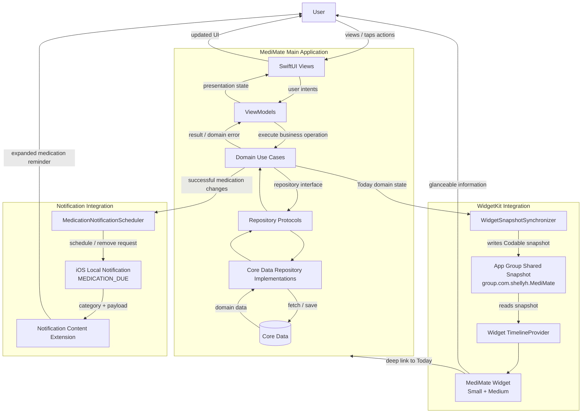
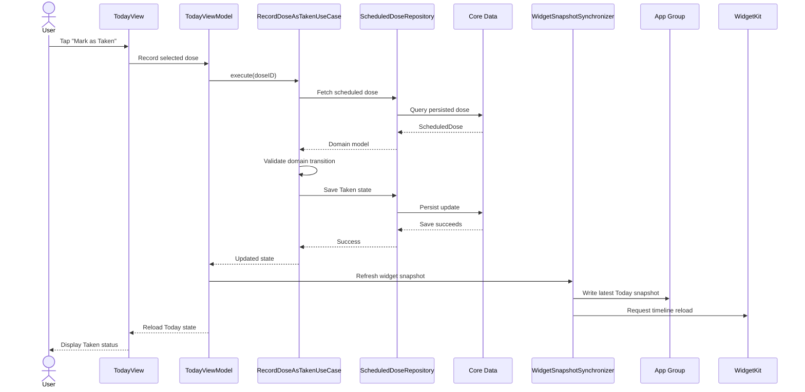
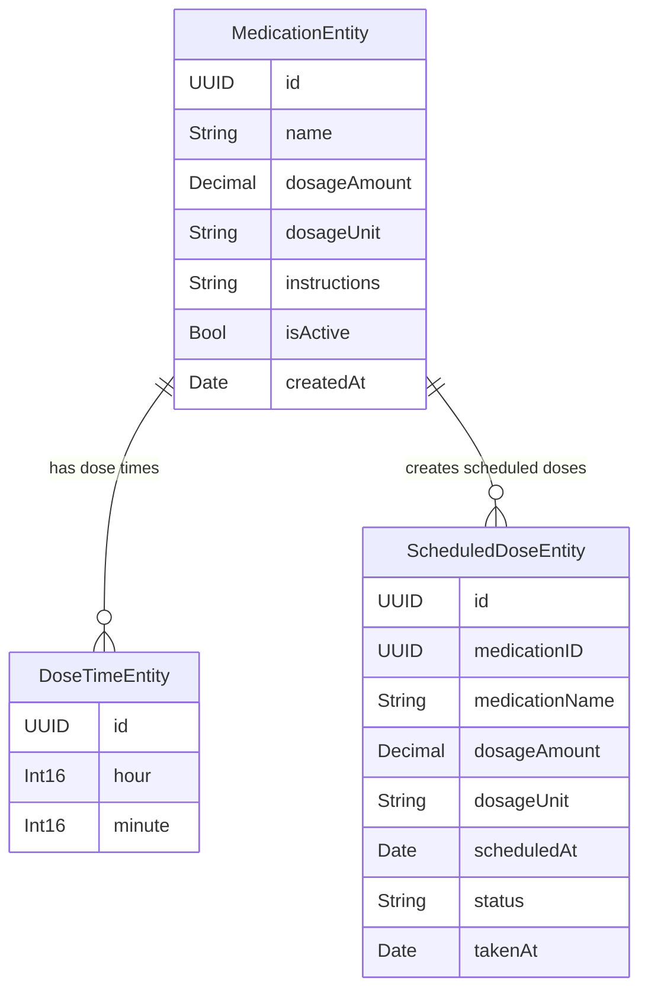
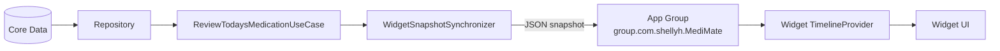

# MediMate

<div align="center">

### Medication Routine & Dose Tracker

**Schedule · Remind · Record · Review**

A focused iOS application that helps adults independently manage recurring medication routines and reduce uncertainty around what is scheduled and what has already been recorded.

</div>

---

## Overview

MediMate is an iOS medication routine and dose-tracking application designed for adults who independently manage recurring medications at home.

The application focuses on three practical questions:

1. **What medication is scheduled?**
2. **When is it scheduled?**
3. **Have I already recorded it?**

The core workflow is intentionally focused:

> **Schedule → Remind → Record → Review**

MediMate combines a SwiftUI main application, Core Data persistence, a WidgetKit extension, and a Notification Content Extension so that medication information is available both inside and outside the main application.

> **Important:** MediMate is a medication routine and record-tracking tool. It does not provide diagnosis, dosage recommendations, drug-interaction advice, or clinical decision support.

---

## Problem Domain

Managing recurring medications is not only a memory problem.

A person managing several medications may need to keep track of:

- different medication names;
- different dosages;
- several scheduled times during the day;
- whether a scheduled dose has already been recorded;
- whether the medication schedule has changed.

The resulting uncertainty can create friction even when the user remembers the medication itself.

For example, a user may remember taking a medication but later be unsure whether they recorded it. Alternatively, they may see a scheduled medication later in the day and need to quickly determine what is still unresolved.

MediMate addresses this by keeping the medication routine visible, recordable, and reviewable.

---

## Primary Stakeholder

The primary stakeholder is:

> **An adult who independently manages multiple recurring medications at home.**

The stakeholder is not assumed to be a clinician, caregiver, or technically advanced user.

The design therefore prioritises:

- fast recognition rather than recall;
- clear medication names and dosage information;
- visible scheduled times;
- large and understandable actions;
- glanceable reminders outside the main app;
- simple correction of recorded activity;
- minimal medical assumptions.

---

## Product Principles

### 1. Medication information before decoration

The most important hierarchy on the Today screen is:

> **Time → Medication → Dosage → Action**

The design intentionally avoids unnecessary greetings, oversized branding, decorative dashboards, adherence scores, and visual elements that do not help the user complete their medication-recording task.

---

### 2. Record state without making unsupported medical assumptions

MediMate knows what has been recorded in the application.

It does not know with certainty what physically happened outside the application.

For example, when a scheduled time has passed without a record, the Widget can display:

> **Not recorded yet**

rather than:

> You forgot your medication.

The first statement is supported by application data. The second would be an unsupported assumption.

---

### 3. Do not silently rewrite history

Changes to a recurring medication definition should not silently change previously recorded activity.

Finalized medication records therefore preserve historical snapshot information.

---

### 4. User corrections should be explicit

The system does not automatically rewrite historical records.

However, the user can explicitly correct their own records when they identify a mistake.

---

### 5. Keep the first version focused

MediMate intentionally concentrates on one medication-routine workflow rather than attempting to become a broad healthcare platform.

---

# Core User Experience

## Today

The Today screen is the primary action-focused interface.

Users can:

- view today's scheduled medication moments;
- identify the current or next relevant medication time;
- see medications grouped by scheduled time;
- view medication name and dosage;
- mark an individual dose as Taken;
- Skip an individual dose;
- mark all unresolved medications in a medication moment as Taken;
- undo a finalized Taken or Skipped record;
- view today's recording progress.

Medications scheduled within the same local calendar minute are presented together as a **Medication Moment**.

Medication Moments are presentation-only.

Each medication occurrence remains an independent `ScheduledDose` record in persistence.

---

## Medications

The Medications screen acts as the user's medication library.

Users can:

- browse active medications;
- browse inactive medications;
- add a medication;
- open medication details;
- edit medication information;
- deactivate a medication;
- permanently delete a medication when domain rules allow it.

The interface prioritises:

> Medication name → Dosage → Schedule

---

## Medication Detail

The Medication Detail screen provides a readable summary of one recurring medication.

It includes:

- medication name;
- dosage;
- schedule;
- daily dose times;
- optional instructions;
- active/inactive state;
- access to editing.

---

## Medication Form

The Medication Form supports both adding and editing a medication.

The form is organised around:

- Medication
- Dosage
- Schedule
- Instructions

The current recurrence model is intentionally focused on:

> **Every day at one or more selected times**

In edit mode, the user can also access:

- Deactivate Medication
- Delete Medication

---

## Activity

Activity provides a chronological view of finalized medication records.

Users can:

- review Taken records;
- review Skipped records;
- review Missed records;
- view records grouped by day;
- view records grouped into medication moments;
- correct a finalized record by marking it as not taken.

Upcoming and Due records remain part of Today rather than being shown as historical Activity.

---

# Functional SwiftUI Screens

MediMate contains at least five distinct functional screen concepts designed around the stakeholder workflow.

| Screen | Purpose |
|---|---|
| Today | Review and record today's medication moments |
| Medications | Browse active and inactive medications |
| Medication Detail | Review one medication and its recurring schedule |
| Medication Form | Add or edit medication details, dosage and dose times |
| Activity | Review and correct finalized medication records |

---

# iOS Platform Integration

MediMate includes two iOS system extensions that serve different parts of the medication workflow.

---

# WidgetKit Extension

**Target:** `MediMateWidgetExtension`

Supported families:

- `.systemSmall`
- `.systemMedium`

The Widget reads a lightweight shared snapshot from an App Group rather than accessing Core Data directly.

---

## Why a Widget?

Medication information is often useful before the user has opened the application.

For example, if a medication is scheduled for 5:00 PM, the user can glance at the Home Screen and see that a medication is coming up.

When the scheduled time is reached, the Widget changes its emphasis.

If the time passes without a record, the Widget can indicate that the medication is still **not recorded yet**.

This supports two realistic situations:

1. the user sees the Widget and remembers that a medication is due;
2. the user has already taken the medication but sees the Widget and realises that it has not yet been recorded.

The Widget therefore reduces the need to repeatedly open the full application simply to inspect the next medication time.

---

## Widget Presentation States

The Widget uses presentation states including:

### Up next

```text
Today

Up next

5:00 PM
1 medication left
```

### Due now

```text
Today

Due now

5:00 PM
1 medication due
```

### Not recorded yet

```text
Today

Not recorded yet

5:00 PM
Tap to review
```

### All set

```text
Today

All set

4 of 4 recorded
```

These are Widget presentation states.

They do not introduce additional persisted Domain statuses.

---

## Widget Interaction

Tapping the Widget deep-links into MediMate and opens the Today tab.

The current version intentionally does not write Taken state directly from the Widget.

This keeps Core Data as the authoritative source of truth and avoids creating competing persistence paths inside the Widget extension.

---

# Notification Content Extension

**Target:** `MediMateNotificationContent`

Notification category:

```text
MEDICATION_DUE
```

The main application schedules local medication notifications using `UNUserNotificationCenter`.

The expanded notification uses a custom Notification Content Extension.

---

## Why a Notification Content Extension?

Medication schedules are time-sensitive.

The stakeholder may not be looking at MediMate or at the Home Screen when a medication reaches its scheduled time.

A local notification therefore surfaces the medication event at the relevant time.

The custom Notification Content Extension improves the notification by displaying meaningful medication-domain information such as:

- scheduled time;
- medication name;
- dosage;
- medication count when multiple records share the same scheduled moment.

This reduces the need for the user to open MediMate simply to understand which medication the reminder refers to.

The notification remains informational.

It does not tell the user that they must take an overdue medication and does not make medical judgements about whether medications are safe to take together.

---

# Architecture

MediMate uses:

> **MVVM + Use Case Layer + Repository Pattern**

The primary dependency direction is:

```text
SwiftUI View
      ↓
ViewModel
      ↓
Use Case
      ↓
Repository Protocol
      ↓
Repository Implementation
      ↓
Core Data
```

Views and ViewModels do not call Core Data APIs directly.

Use Cases contain business rules.

Repository protocols separate Domain logic from persistence implementation.

---

# Architecture Diagram



---

# Primary Use Case Data Flow

One of MediMate's primary workflows is recording a scheduled dose as Taken.



---

# Domain Model

## Medication

`Medication` represents a recurring medication definition.

It includes:

- identifier;
- medication name;
- dosage;
- optional instructions;
- dose schedule;
- active/inactive state;
- creation date.

---

## Dosage

A `Dosage` consists of:

- amount;
- dosage unit.

Supported units include:

- mg
- mcg
- g
- mL
- tablet
- capsule

The Domain layer validates that dosage amount is greater than zero.

---

## DoseTime

`DoseTime` represents a daily wall-clock time using:

- hour;
- minute.

It intentionally represents a recurring time rather than an absolute `Date`.

---

## DoseSchedule

`DoseSchedule` represents one or more daily dose times.

The Domain layer enforces rules including:

- at least one dose time;
- no duplicated dose times;
- deterministic ordering.

---

## ScheduledDose

`ScheduledDose` represents one concrete occurrence of a medication.

It includes:

- scheduled dose ID;
- medication ID;
- medication-name snapshot;
- dosage snapshot;
- scheduled date/time;
- status;
- optional Taken timestamp.

Supported statuses:

- Upcoming
- Due
- Taken
- Skipped
- Missed

---

# Historical Snapshot Design

A `ScheduledDose` stores a snapshot of medication name and dosage.

This is intentional denormalisation.

For example, if a user records:

```text
Pill A
1 tablet
```

and later edits the recurring medication dosage, the historical ScheduledDose does not silently change to the new dosage.

This provides more stable historical records at the cost of storing a small amount of duplicated information.

---

# Medication Moments

Multiple Scheduled Doses occurring within the same local calendar minute are grouped into a presentation-only `MedicationMoment`.

For example:

```text
12:00 PM

Metformin
Vitamin D
Pill A
```

The underlying records remain independent ScheduledDose objects.

No `MedicationMoment` Core Data entity is created.

This design allows batch interaction without unnecessarily increasing persistence complexity.

---

# Use Case Layer

Significant business operations are encapsulated in semantic Domain Use Cases.

Examples include:

| Use Case | Responsibility |
|---|---|
| `ScheduleMedicationUseCase` | Generate scheduled medication occurrences |
| `RecordDoseAsTakenUseCase` | Validate and record a Taken dose |
| `SkipScheduledDoseUseCase` | Validate and record a skipped dose |
| `ReviewTodaysMedicationUseCase` | Build the current Today summary |
| `ReviewMedicationsUseCase` | Retrieve medications for management |
| `AddMedicationUseCase` | Create a medication |
| `UpdateMedicationUseCase` | Update medication information |
| `DeactivateMedicationUseCase` | Disable future recurring medication activity |
| `AddMedicationAndScheduleUseCase` | Add a medication and create future Scheduled Doses |
| `UpdateMedicationAndRescheduleUseCase` | Safely replace unresolved schedule occurrences |
| `CorrectDoseRecordUseCase` | Support explicit user correction |
| `ReviewMedicationHistoryUseCase` | Retrieve finalized medication activity |
| `DeleteMedicationUseCase` | Enforce safe permanent deletion |
| `RecordMedicationMomentAsTakenUseCase` | Batch-record unresolved doses in one moment |

Use Cases enforce domain rules and expose typed domain-specific failures rather than persistence implementation details.

---

# Selected Business Rules

## Taken / Skip recording

MediMate validates state transitions before persisting a record.

A user action must pass through the relevant Use Case rather than directly mutating persistence.

---

## Editing a medication schedule

When a recurring schedule changes:

- unresolved same-day/future Scheduled Doses may be replaced;
- finalized Taken and Skipped records are preserved;
- previous calendar days are not silently rewritten.

This protects recorded history while allowing the current schedule to change.

---

## Permanent deletion

Permanent deletion is only allowed when no recorded history exists.

If any related Scheduled Dose contains:

- Taken;
- Skipped;
- Missed

then permanent deletion is blocked.

The user can deactivate the medication instead.

---

## User correction

MediMate follows the principle:

> **The system must not silently rewrite history, but the user can explicitly correct their own records.**

A user can revert an incorrect finalized record to not taken.

The resulting unresolved state is derived from the scheduled time.

---

# Database Choice

MediMate uses:

> **Core Data**

as the primary persistent database.

---

## Why Core Data?

The primary stakeholder requires medication information to be:

- private;
- quickly available;
- usable without an internet connection;
- stored reliably between app sessions.

The current MediMate workflow is:

- single-user;
- primarily local;
- not collaborative;
- not dependent on cross-user sharing.

For these reasons, local Core Data persistence is more appropriate for this version than introducing CloudKit synchronisation.

Core Data also supports structured relationships and predicate-based queries that match MediMate's domain model.

---

# Core Data Model

The persistent model contains three related entities.

## MedicationEntity

Stores a recurring medication definition.

Important persisted data includes:

- ID
- name
- dosage amount
- dosage unit
- instructions
- active state
- creation date

Relationships include:

- dose times;
- scheduled doses.

---

## DoseTimeEntity

Stores recurring daily times.

Important data includes:

- ID
- hour
- minute

Each DoseTime belongs to a Medication.

---

## ScheduledDoseEntity

Stores concrete medication occurrences.

Important data includes:

- ID
- medication ID snapshot
- medication name snapshot
- dosage amount snapshot
- dosage unit snapshot
- scheduled date/time
- status
- optional Taken timestamp

---

# Core Data Relationships



Medication → DoseTime uses a cascade relationship because Dose Times belong to the recurring medication definition.

Scheduled Doses preserve snapshot values so that recorded history does not depend on the current medication definition.

---

# Repository Layer

Database access is abstracted behind repository protocols.

Main protocols include:

- `MedicationRepository`
- `ScheduledDoseRepository`

Core Data implementations include:

- `CoreDataMedicationRepository`
- `CoreDataScheduledDoseRepository`

Views and ViewModels never call Core Data directly.

---

## Meaningful Queries

Repository operations include meaningful domain predicates such as:

- Scheduled Doses within a date range;
- Scheduled Doses belonging to a medication ID.

For example, Today review retrieves medication occurrences within the current calendar day rather than loading the entire database into the UI.

---

# Widget Data Architecture

The Widget does not access Core Data directly.

Instead, the main application creates a lightweight Codable snapshot.



App Group identifier:

```text
group.com.shellyh.MediMate
```

Snapshot storage key:

```text
medimate.widget.snapshot.v1
```

The shared snapshot contains only information required by the Widget, including:

- today's medication names;
- dosage text;
- scheduled times;
- recording progress;
- finalized/unresolved state.

It intentionally does not share:

- medication instructions;
- Activity history;
- Core Data entities;
- repository implementation details.

Core Data remains the application's source of truth.

---

# Widget Update Strategy

The main application regenerates the Widget snapshot after relevant data changes.

Examples include:

- Mark as Taken;
- Skip;
- Undo;
- Mark all / remaining as Taken;
- Add medication;
- Edit medication;
- reschedule medication;
- deactivate medication;
- delete medication.

After the snapshot is updated, the application requests a WidgetKit timeline reload.

Predictable medication times are also used to prepare future Widget timeline states.

---

# Notification Architecture

Medication notifications are managed by:

`MedicationNotificationScheduler`

The scheduler:

- registers the `MEDICATION_DUE` category;
- schedules local medication reminders;
- uses medication schedule data;
- includes minimal presentation payload data;
- removes/reconciles pending notifications after relevant medication changes.

The Notification Content Extension receives only the notification content and payload required for presentation.

It does not access:

- Core Data;
- repositories;
- Widget App Group storage.

---

# Human-System Boundary

MediMate intentionally distinguishes between:

## What the system knows

- a medication was scheduled;
- a user recorded Taken;
- a user recorded Skipped;
- a record is unresolved;
- a medication was deactivated;
- a medication schedule was changed.

## What the system does not know

- whether a medication was physically swallowed;
- whether an overdue medication should medically be taken;
- whether medications are medically safe to take together;
- why a user did not record a dose.

This boundary influences interface language.

For example:

> **Not recorded yet**

is used rather than:

> **You missed your medication**

when the application only knows that no record exists.

---

# Visual Design

MediMate uses a design direction described as:

> **Warm Wellness × Modern iOS**

The interface uses:

- soft sage and teal accents;
- warm neutral backgrounds;
- adaptive surface colours;
- clear typography hierarchy;
- restrained semantic status badges;
- large tap targets;
- system typography;
- Light and Dark Mode support.

The Today screen deliberately prioritises:

> **Time → Medication → Action**

rather than greetings, decorative branding, or dashboard-style analytics.

---

# Accessibility

Accessibility considerations include:

- Dynamic Type-compatible typography;
- system fonts;
- large interaction targets;
- VoiceOver labels;
- strong information hierarchy;
- status symbols combined with text;
- adaptive Light/Dark Mode colours;
- avoiding colour-only communication.

The interface is designed to remain understandable for adults with different levels of technical familiarity.

---

# Testing Strategy

MediMate contains focused unit and integration tests for important business and persistence behaviour.

---

## Mock Repository Tests

Use Case and ViewModel tests use mock repository implementations so that business rules can be evaluated independently from Core Data.

The test suite covers examples including:

- happy paths;
- invalid input;
- boundary conditions;
- domain error cases;
- Taken and Skip transitions;
- medication scheduling;
- Today review;
- record correction;
- deletion rules;
- medication-moment grouping;
- batch recording.

---

## Core Data Repository Integration Tests

Separate repository tests use an in-memory Core Data persistent store.

These verify:

- Domain ↔ Core Data mapping;
- persistence behaviour;
- date-range predicates;
- medication-ID predicates;
- repository save/fetch behaviour.

The in-memory store prevents tests from modifying the application's real persistent data.

---

## Manual Integration Testing

Platform-extension workflows were also manually verified in the iOS Simulator.

### Widget

```text
Medication change
      ↓
Core Data persistence
      ↓
Widget snapshot regeneration
      ↓
App Group update
      ↓
WidgetCenter reload
      ↓
Small / Medium Widget displays real data
```

The Widget was also tested for deep-linking back to Today.

---

### Notification Content Extension

```text
Scheduled medication
      ↓
Local notification
      ↓
MEDICATION_DUE
      ↓
Notification Content Extension
      ↓
Custom expanded MediMate UI
```

The custom expanded notification was verified with real medication:

- scheduled time;
- medication name;
- dosage.

---

# Git Workflow

`main` is used as the stable integration branch.

Major features were developed using feature branches.

Examples include:

```text
feature/domain-foundation
feature/core-data
feature/medication-management
feature/today-dashboard
feature/history
feature/widget
feature/notification-extension
```

Commit messages follow Conventional Commit conventions such as:

```text
feat: add medication widget integration
fix: refine widget status wording
feat: add medication notification content extension
feat: add MediMate app icon
feat: add medication activity timeline
feat: redesign MediMate visual system
fix: reschedule unresolved same-day doses
docs: ...
test: ...
```

---

# Project Structure

```text
MediMate/
├── Data/
│   ├── Persistence/
│   └── Repositories/
│
├── Domain/
│   ├── Models/
│   ├── Repositories/
│   └── UseCases/
│
├── Notifications/
│   └── MedicationNotificationScheduler.swift
│
├── Presentation/
│   ├── ViewModels/
│   └── Views/
│
├── Widget/
│   └── WidgetSnapshotSynchronizer.swift
│
└── MediMateApp.swift

MediMateShared/
└── MedicationWidgetSnapshot.swift

MediMateWidget/
├── MediMateWidget.swift
└── MediMateWidgetBundle.swift

MediMateNotificationContent/
├── NotificationViewController.swift
├── MainInterface.storyboard
└── Info.plist

MediMateTests/
└── Unit and integration tests
```

---

# Assessment Implementation Summary

| Assessment Requirement | MediMate Implementation |
|---|---|
| Original application | MediMate is a new medication-routine project |
| Specific stakeholder | Adult independently managing recurring medications at home |
| Persistent database | Core Data |
| Related entities | MedicationEntity, DoseTimeEntity, ScheduledDoseEntity |
| Meaningful predicates | Date-range and medication-ID dose queries |
| Repository abstraction | MedicationRepository and ScheduledDoseRepository protocols |
| MVVM | SwiftUI Views + ViewModels |
| Use Case Layer | Semantic business-operation Use Cases |
| Domain models | Medication, Dosage, DoseTime, DoseSchedule, ScheduledDose |
| Typed domain errors | Business Use Cases expose domain-specific failures |
| Functional screens | Today, Medications, Medication Detail, Medication Form, Activity |
| Extension 1 | WidgetKit Widget Extension |
| Widget families | systemSmall + systemMedium |
| App Group | `group.com.shellyh.MediMate` |
| Widget data updates | Snapshot regenerated + WidgetCenter reload |
| Extension 2 | Notification Content Extension |
| Notification category | `MEDICATION_DUE` |
| Custom notification content | Scheduled time, medication name, dosage |
| Minimum unit testing | Exceeded |
| Mock repositories | Used for Use Case / ViewModel tests |
| Repository integration tests | In-memory Core Data |
| Feature branches | Used for major features and extensions |
| Conventional Commits | Used throughout Git history |
| Complete README | Project, architecture, extensions, database, setup and attribution documented |

---

# Setup Instructions

## Requirements

- macOS
- Xcode 26.x
- compatible iOS Simulator or iOS device
- Apple development signing configured in Xcode

---

## Run the Main Application

1. Clone the repository.
2. Open:

```text
MediMate.xcodeproj
```

3. Select the `MediMate` scheme.
4. Select a compatible iOS Simulator or device.
5. Configure signing if necessary.
6. Build and run the application.
7. Allow notification permission when requested.

---

# App Group Setup

MediMate uses the following App Group:

```text
group.com.shellyh.MediMate
```

Confirm that the App Group capability is enabled for:

- `MediMate`
- `MediMateWidgetExtension`

Both targets must use the same App Group.

---

# Testing the Widget

1. Run MediMate at least once.
2. Add a medication scheduled for today.
3. Return to the iOS Home Screen.
4. Add the MediMate Widget.
5. Test both supported sizes:
   - Small
   - Medium
6. Record or edit medication data in MediMate.
7. Confirm the Widget updates.
8. Tap the Widget.
9. Confirm MediMate opens to Today.

---

# Testing Medication Notifications

1. Run MediMate.
2. Allow notification permission.
3. Create a medication scheduled shortly in the future.
4. Background the application.
5. Wait for the local medication notification.
6. Long-press or expand the notification.
7. Confirm the custom MediMate notification interface appears.
8. Verify:
   - scheduled time;
   - medication name;
   - dosage.

---

# Deliberate Scope

The current version intentionally does not include:

- medical diagnosis;
- dosage recommendations;
- drug-interaction checking;
- medication-safety recommendations;
- caregiver accounts;
- clinician accounts;
- CloudKit synchronisation;
- HealthKit;
- Apple Watch;
- OCR medication recognition;
- barcode scanning;
- external medication databases;
- adherence scores;
- streaks;
- gamification;
- Live Activities;
- interactive Taken actions inside the Widget.

This keeps the product focused on:

> **Schedule → Remind → Record → Review**

---

# Known Limitations and Future Improvements

The current version deliberately leaves several areas for future development.

## Historical Taken correction

A finalized record can be reverted to not taken.

However, changing an older historical record back to Taken would require the user to provide an explicit Taken time.

The application intentionally avoids inventing a historical Taken timestamp.

---

## Deactivation and same-day unresolved records

Deactivating a medication stops future scheduling and notifications.

An already-created unresolved ScheduledDose from earlier the same day can remain part of the day's record.

A future version could improve the Widget presentation of this situation without deleting or fabricating historical data.

---

## More flexible recurrence

The current schedule model supports daily medication times.

Future versions could support:

- selected weekdays;
- interval-based schedules;
- start/end dates;
- temporary medication courses.

---

## Interactive Widget recording

A future Widget could potentially support direct Taken recording.

This was intentionally deferred because Core Data is currently owned by the main application, and adding Widget-side write behaviour would require careful persistence and consistency design.

---

# AI-Assisted Development

OpenAI ChatGPT and Codex were used as development tools during this project.

They were used to assist with:

- architecture discussion and implementation planning;
- generating and refining implementation scaffolding;
- drafting and refining selected unit tests;
- debugging Swift, SwiftUI, Core Data, WidgetKit, and notification integration;
- reviewing implementation changes;
- iterating UI layouts and visual design;
- generating early visual concepts;
- generating the MediMate app icon.

AI-generated output was treated as a draft rather than as an authoritative solution.

I reviewed generated code and suggestions against:

- the assessment requirements;
- the intended medication-domain behaviour;
- Apple platform behaviour;
- Xcode builds and type checking;
- unit and integration tests;
- Git diffs;
- manual Simulator testing.

Several AI suggestions were changed, refined, or rejected during development.

Examples include:

- keeping schedule validation in the Domain layer rather than relying on Core Data constraints;
- preserving historical ScheduledDose snapshots when medication definitions change;
- changing same-day rescheduling after manual testing exposed stale unresolved Scheduled Doses;
- supporting explicit user correction without allowing the system to silently rewrite historical records;
- grouping ScheduledDose records into presentation-only Medication Moments instead of adding another Core Data entity;
- keeping Core Data out of the Widget extension and using a small App Group snapshot;
- using **Not recorded yet** rather than assuming an unresolved medication was physically missed;
- deferring direct Widget-based Taken recording because safely implementing it would require additional persistence integration.

The final submitted behaviour and architecture were therefore reviewed and evaluated rather than accepting generated output without verification.

---

# Third-Party Dependencies

MediMate does not use third-party Swift Package Manager dependencies.

The implementation relies on Apple platform frameworks including:

- SwiftUI
- Core Data
- WidgetKit
- UserNotifications
- UserNotificationsUI

---

# Apple Documentation and Attribution

Apple Developer Documentation was used as the primary platform reference during development.

Key documentation areas included:

- Core Data
- Core Data Stack
- Configuring App Groups
- WidgetKit
- Creating a Widget Extension
- Developing a WidgetKit Strategy
- Keeping a Widget Up to Date
- WidgetCenter
- UserNotifications
- Notification Content Extensions
- UNNotificationContentExtension

No third-party application source code was used as the foundation of this project.

---

# Design Trade-offs

## Core Data instead of CloudKit

MediMate currently prioritises local privacy, offline availability, and a single-user medication workflow.

Cloud collaboration and multi-device synchronisation were therefore not required for the first version.

---

## Historical snapshot duplication

ScheduledDose stores medication name and dosage snapshots.

This creates deliberate data duplication.

The benefit is that historical activity remains stable after a recurring medication definition changes.

---

## Widget snapshot instead of direct database access

The Widget reads a minimal shared snapshot rather than directly accessing Core Data.

This introduces a synchronisation step, but keeps the Widget independent from the application's persistence implementation.

---

## Explicit correction instead of automatic history rewriting

MediMate permits explicit user correction but avoids automatically changing finalized activity in response to later medication-definition changes.

This prioritises traceable user intent over automatic convenience.

---

# Future Direction

Potential future development could include:

- richer historical correction with explicit Taken-time selection;
- more flexible recurrence rules;
- optional CloudKit synchronisation;
- configurable Widget privacy;
- direct Widget actions with a safe shared persistence strategy;
- richer medication-course scheduling;
- improved handling of unresolved same-day records after medication deactivation.

These features are intentionally outside the current scope.

---

# Technologies Used

- Swift
- SwiftUI
- Core Data
- WidgetKit
- App Groups
- UserNotifications
- UserNotificationsUI
- XCTest
- Swift Testing

---

# Assessment Documentation

The submitted assessment PDF contains the required:

1. Problem Statement
2. Design Justification
3. One-page Architecture Diagram
4. 700–900 word Reflective Report

The README provides a technical and product overview of the implemented application, while the assessment PDF contains the formal evidence, justification, reflection, and problem-source documentation required by the assessment.

---

<div align="center">

## MediMate

### A focused medication routine for scheduling, reminding, recording, and reviewing.

</div>
